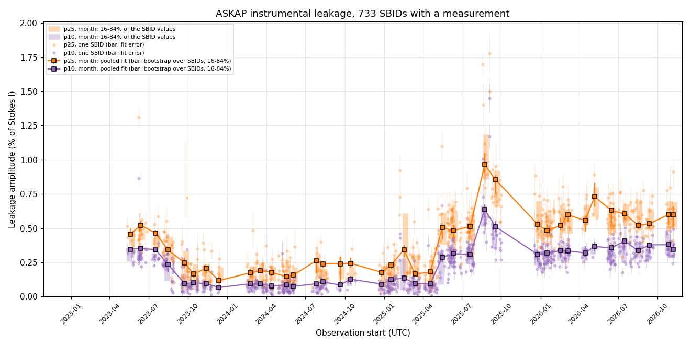
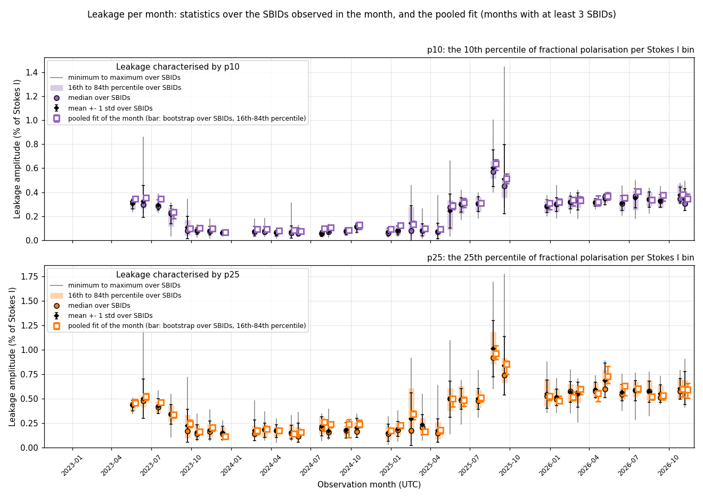
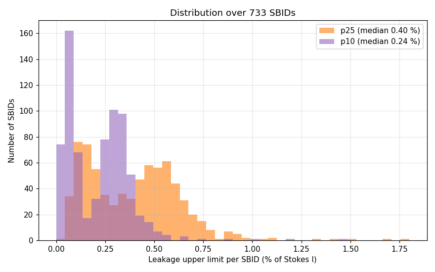
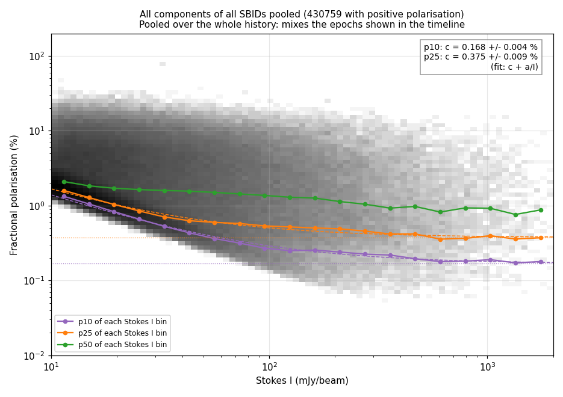
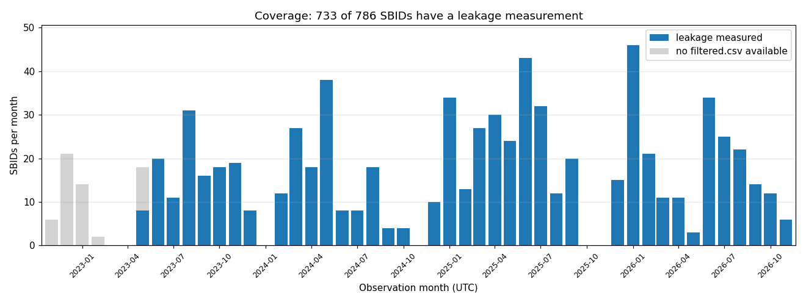
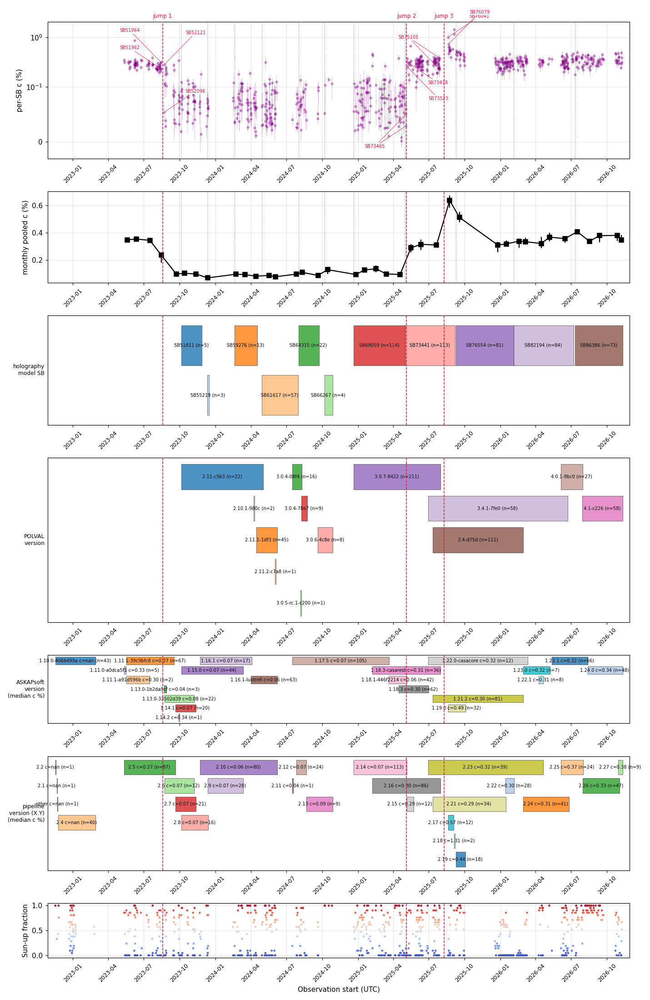
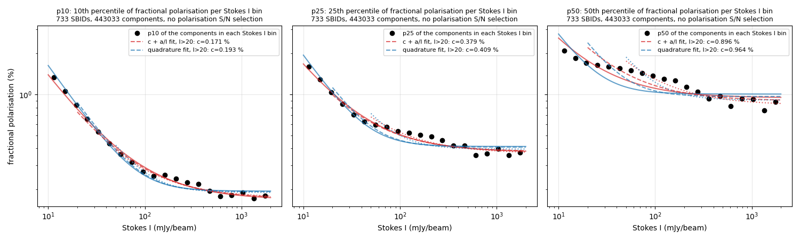

# askap-polarimetry

How large is the instrumental polarisation leakage of ASKAP, and how has it
changed over time? This repository measures it for every EMU/POSSUM
observation (SBID) that has a validation table on CASDA, ties each value to
the observation time and the software that processed it, and records the
history.

**Coverage:** 786 SBIDs observed from 2022-11-16 to 2026-11-08, listed in order
of observation time. 733 have a leakage measurement; the 53 earliest (to
2023-05-23) have no validation report on CASDA.

## Historical Leakage (Per SBID)

One frame per SBID in observation order: its components, the fit and its place
in the history. The latest render:

Watch it at **https://wasimraja81.github.io/askap-polarimetry/**, or download
the file from the [`movie-latest` release](../../releases/tag/movie-latest).

## Result

The leakage is reported as an **upper limit, in percent of Stokes I**, from the
10th percentile (p10) and the 25th percentile (p25) of the fractional
polarisation of all components at high Stokes I. See [How it is measured](#how-it-is-measured)
for what that means and what it assumes.



Monthly pooled p10 leakage:

| Observation period | p10 upper limit (%) |
|---|---|
| May to Jul 2023 | about 0.35 |
| Sep 2023 to Apr 2025 | 0.07 to 0.13 |
| May to Jul 2025 | about 0.3 |
| Aug to Sep 2025 | up to 0.64 (transient) |
| Dec 2025 to Nov 2026 | 0.31 to 0.41 |

The spread of the SBID values within each month (mean, median, standard
deviation, 16th to 84th percentile, minimum and maximum), with the pooled fit of
the month and its bootstrap range overlaid:



p25 is higher than p10 because it includes more sources with intrinsic
polarisation (median difference between the two across SBIDs: 0.16 %). Across
SBIDs the median upper limit is 0.24 % (p10) and 0.40 % (p25); the distribution
is bimodal:



All components pooled, with the percentiles and fits used to obtain the
numbers (this pools the whole history, so its `c` averages the periods in the
table above):



Coverage by month:



`python src/make_movie.py` renders a movie with one frame per SBID (the data
for each SBID, its fit and its place in the history); see
[docs/CODE.md](docs/CODE.md). The movie file is not stored in the repository; the latest render is attached to
the [`movie-latest` release](../../releases/tag/movie-latest) and replaced each
time `develop` is merged into `main`.

The measurements are in [`results/sbs_all_time_ordered.csv`](results/sbs_all_time_ordered.csv):
one row per SBID with observation time, leakage values and errors, quality
flag, software versions and the holography model.

## What the leakage depends on

The level changes between about 0.1 % and 0.3 %, and the changes line up with
the **ASKAPsoft build** used to process the data more than with the observation
date: of 40 SBIDs processed more than 60 days after they were observed, 38
sit at the level of the build that processed them and 2 do not. The transitions match release-note entries about the Stokes Q/U
leakage correction in `linmos` (ASKAPsoft 1.13.0) and about its wide-field
leakage calculation (1.18.2/1.18.3). This is an association, not an
established cause. The evidence, the counter-checks and the open questions
are in [docs/DIAGNOSTICS.md](docs/DIAGNOSTICS.md); the figures are in
`diagnostics/outputs/`.



## How it is measured

For each SBID, using the POSSUM `filtered.csv` component table:

1. Bin all components in Stokes I (20 log bins, 10 to 2000 mJy/beam).
2. In each bin take the 10th (or 25th) percentile of the fractional
   polarisation: sort the components by fractional polarisation and take the
   value at the 10 % (or 25 %) position.
3. Fit `c + a / I` to the bin values. `c` is the leakage; `a / I` absorbs the
   noise term that dominates at low Stokes I.

Why a low percentile: the instrument adds a polarisation floor to every
source, and intrinsically polarised sources add to it, so the leakage is
best read from the least polarised sources. No selection on polarisation S/N
is used, because at high Stokes I a source with leakage-level polarisation
already exceeds any S/N limit and would be removed.

The numbers are upper limits **if the leakage amplitude is the same for every
source**. Beam and position dependence has not been examined; the
measurement is one number per SBID.



Details of the method, the table columns and every script are in
[docs/CODE.md](docs/CODE.md).

## Reproducing

```
python3 -m venv ~/.venv/askap-polarimetry
~/.venv/askap-polarimetry/bin/python -m pip install -r requirements.txt
```

Run the scripts from the repository root, in this order (details in
[docs/CODE.md](docs/CODE.md)):

```
python src/download_filtered.py --output_dir data/all_filtered
python src/sbid_metadata.py
python src/build_results_table.py --filtered_dir data/all_filtered
python src/plot_history.py --filtered_dir data/all_filtered
```

The component tables (`filtered_SB*.csv`) are not stored in the repository;
`download_filtered.py` fetches them from CASDA, which needs no login. Checks
that the earlier analysis is reproduced are in
[docs/REPRODUCIBILITY.md](docs/REPRODUCIBILITY.md).

## Open

- Leakage in Stokes Q, U and V separately.
- Beam-dependent leakage.
- The cause of the Aug to Sep 2025 transient.
- A bandpass SBID is not recorded in the validation reports.

## Layout

| Path | Content |
|---|---|
| `src/` | Download, metadata, leakage estimate, results table, plots |
| `results/` | The results table and the per-SBID metadata |
| `figures/` | The measured history |
| `diagnostics/` | Scripts and figures that look for causes |
| `docs/` | Method and scripts, diagnostics, reproducibility |
| `CLAUDE.md` | Working rules for this repository |

## Licence and data

The code, documents and figures in this repository are released under the MIT
licence (see `LICENSE`). The input tables (`filtered.csv` from the POSSUM
validation reports on CASDA) are not stored here; `src/fetch_filtered.py`
downloads them from the public object store, and `results/filtered_manifest.csv`
lists the size and checksum expected for each file. Data access and
acknowledgement follow the CASDA terms of use.
